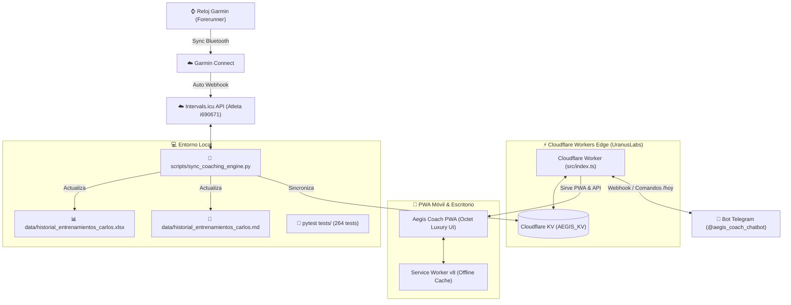

# 🏃‍♂️ Aegis Coach — Sistema de Inteligencia y Coaching de Carlos Jiménez Andrino

[](https://aegis-intervals-sync.uranuslabs.workers.dev)
[](scripts/sync_coaching_engine.py)
[](https://t.me/aegis_coach_chatbot)
[](tests/)

Plataforma integral de coaching fisiológico de alto rendimiento, planificación de fuerza, sincronización automática con Garmin / Intervals.icu y PWA móvil de lujo para **Carlos Jiménez Andrino**.

---

## 📌 1. Perfil del Atleta y Ventana de Verdad Cuantitativa

* **Atleta:** Carlos Jiménez Andrino (23 años, 63 kg, 1.73 m).
* **Hito de Rendimiento Reciente:** 10K Media Maratón Ávila Monumental (08/11/2026) en **38:26 oficial (3:50/km)** a 1.070 m de altitud con viento y desnivel.
* **Próximos Objetivos:**
  1. **Cross Popular Parque del Soto (Ávila):** 28 de Noviembre de 2026 (5 km en hierba/tierra @ 3:30/km ~17:30).
  2. **San Silvestre:** 31 de Diciembre de 2026 (6.5 km @ sub 3:35/km).
* **Regla de las 8–12 Semanas:** Todas las zonas de entrenamiento, ritmos objetivo, proyecciones de marca y pesos en el gimnasio se calculan **exclusivamente con los datos de las últimas 8 a 12 semanas**. Su marca histórica de 1:54.51 en 800m de hace 3 años se utiliza únicamente como etiqueta de perfil neuromuscular cualitativo (predominio de fibras rápidas Tipo IIa/IIx, alta RFD y necesidad de micro-intervalos o pausas de 90"-2' en series de VO2max).
* **Puntos Críticos Biomecánicos:**
  - *Isquiotibial proximal izquierdo (MTJ):* Rotura superada, asintomático (0/10 dolor). Blindado con Hip Thrust y RDL unilateral.
  - *Rodilla izquierda:* Antecedente de derrame sinovial reactivo (05/11/2026). Monitorización y sustitución de sentadillas libres profundas por **Spanish Squat isométrica con banda** y **Box Squat** a cajón paralelo.

---

## ⚡ 2. Arquitectura del Ecosistema



---

## 📱 3. La Web App PWA Móvil

* **URL en Producción:** [https://aegis-intervals-sync.uranuslabs.workers.dev](https://aegis-intervals-sync.uranuslabs.workers.dev)
* **Diseño y Paleta de Colores:** Basado en la paleta oficial **Octet Interactive Dashboards**:
  - *River Styx* (`#171821`): Fondo ambiental profundo.
  - *Jaguar* (`#292631`): Superficie de tarjetas luxury con borde sutil `#4d3e50`.
  - *Middy's Purple* (`#a887ce`): Acento primario lavanda / púrpura brillante.
  - *Mulberry Mix* (`#9c526d`) / *Vibrant Rose* (`#d86991`): Acentos magenta en curvas y llamadas a la acción.
* **Autonomía Offline:**
  - **Service Worker `v8`:** Estrategia *Network-First* para el documento principal (actualizaciones instantáneas) con fallback offline completo.
  - **Bypass Cross-Origin:** Las peticiones a CDNs no son interceptadas para evitar bloqueos en navegadores estrictos (Brave Shields).
  - **CSS Precompilado (`/css/app.css`):** Hoja de estilos con las 386 clases de Tailwind almacenada en Cloudflare KV para carga instantánea con cero latencia de compilación.
  - **Iconos Adaptativos 1:1:** Iconos generados con safe-zone del 62% para encajar en cualquier máscara de Android (círculo, squircle, rectángulo redondeado) sin recortes.

---

## 🛠️ 4. Guía Rápida de Comandos para Carlos y Agentes de IA

### A. Sincronización Automática Semanal
Cada domingo o lunes tras entrenar, ejecuta:
```bash
python scripts/sync_coaching_engine.py
```
*Extrae actividades, vueltas, ritmos, FC media, desnivel y notas desde Intervals.icu, actualizando el Excel maestro (`data/historial_entrenamientos_carlos.xlsx`) y el cuaderno Markdown (`data/historial_entrenamientos_carlos.md`).*

### B. Publicar Nuevo Plan de Entrenamiento a la PWA Móvil
Para actualizar el calendario de la semana en la nube:
```bash
python scripts/publish_plan_to_kv.py
```

### C. Desplegar Cambios a Cloudflare Workers
Cualquier modificación en la PWA o en el backend se despliega en segundos:
```bash
cd cloudflare
npx wrangler deploy
```

### D. Ejecutar la Batería Completa de Tests
```bash
python -m pytest tests/
```
*(264 tests pasando: ciberseguridad, headers HTTP, Service Worker, ACWR, Playwright UI, persistencia KV).*

---

## 📂 5. Directorios del Proyecto

| Directorio / Archivo | Estado | Descripción |
| :--- | :--- | :--- |
| `cloudflare/` | 🟢 **Producción** | Código fuente del Worker (`src/index.ts`), configuración de despliegue (`wrangler.toml`), imágenes y suite PWA. |
| `data/` | 🟢 **Producción** | Base de datos relacional Excel (`historial_entrenamientos_carlos.xlsx`), notas técnicas y fotos reales de gimnasio. |
| `scripts/` | 🟢 **Producción** | Scripts de sincronización de Intervals.icu, publicador a KV, generador de iconos PWA y verificadores Playwright. |
| `tests/` | 🟢 **Producción** | Suite de 264 pruebas automatizadas con Pytest y Playwright. |
| `docs/` | 📚 **Documentación** | Manuales técnicos: `ARCHITECTURE.md`, `GARMIN_INTEGRATION_GUIDE.md`, `LOCAL_FOLDER_GUIDE.md` y `ROADMAP.md`. |
| `AGENTS.md` | 🧠 **Reglas Supremas** | Directrices de los agentes de cabecera (Fisiólogo y S&C), mandato anti-complacencia y ritual semanal. |
| `PROJECT.md` | 📋 **Hitos y Tareas** | Inventario técnico de funcionalidades, esquemas de datos y registro de versiones. |
| `poc/` | ⚪ **Legado (Ago 2026)** | Prototipo inicial abstracto multi-tenant en Python (conservado como histórico). |

---

## 🛰️ 6. Integración Garmin Connect & Planes Futuros

Aegis Coach utiliza una **arquitectura híbrida**:
1. **Intervals.icu (Activo):** Sincronización automática en la nube desde el reloj Garmin vía servidor sin intervención manual. Calcula CTL (Fitness), ATL (Fatiga) y TSB (Forma).
2. **Garmin Connect Personal API (En desarrollo):** Conexión directa mediante la nueva API oficial gratuita de Garmin para particulares (`personal.connectapi.garmin.com`) para importar métricas de recuperación matutina (Puntuación de sueño, HRV nocturno y Body Battery).

Para más detalles, consulta [`docs/GARMIN_INTEGRATION_GUIDE.md`](docs/GARMIN_INTEGRATION_GUIDE.md).

---

## 🔒 7. Credenciales y Configuración de Secretos

Las claves de producción se gestionan de forma segura:
* En local: protegidas en `.env` y `cloudflare/.dev.vars` (excluidas en `.gitignore`).
* En Cloudflare: inyectadas como secrets y variables de entorno del Worker (`ATHLETE_ID`, `INTERVALS_API_KEY`, `TELEGRAM_BOT_TOKEN`, `TELEGRAM_CHAT_ID`, `AEGIS_SECRET_KEY`).
