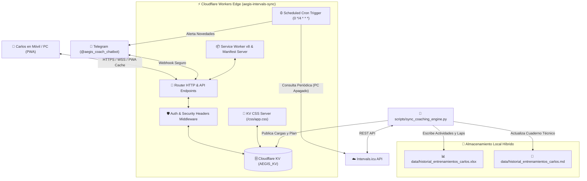

# 🏗️ Arquitectura Técnica de Aegis Coach — Edge Runtime, PWA & KV

Este documento detalla la arquitectura de software de **Aegis Coach**, explicando el funcionamiento del runtime en el Edge de Cloudflare, el esquema de datos en Cloudflare KV, la capa de seguridad y el ciclo de vida del Service Worker v8.

---

## 1. Diagrama de Arquitectura Global



---

## 2. Esquema de Datos en Cloudflare KV (`AEGIS_KV`)

Namespace ID: `2df7fe02551a4ae29074519b8206a301`

### Claves Principales:

#### 1. `current_plan` (JSON)
Contiene la planificación completa del macrociclo y el microciclo actual día a día:
```json
{
  "athlete": {
    "name": "Carlos Jiménez Andrino",
    "weight_kg": 63.0,
    "height_m": 1.73,
    "recent_milestone": "10K Ávila en 38:26 (3:50/km @ 1.070m altitud)"
  },
  "macrocycle": {
    "current_microcycle": "Bloque Pre-Milán & Afinamiento Cross del Soto",
    "primary_objective": {
      "name": "Cross Popular Parque del Soto",
      "date": "2026-11-28",
      "distance_km": 5.0,
      "target_pace": "3:30 - 3:35/km (~17:30)",
      "surface": "Hierba / Tierra compacta"
    }
  },
  "days": [
    {
      "date": "2026-11-16",
      "day_name": "Lunes",
      "display_date": "16 Nov",
      "is_key_session": false,
      "running": {
        "is_rest": false,
        "session_type": "Rodaje Regenerativo Z1-Z2",
        "title": "Rodaje de Drenaje & Soltura",
        "duration_min": 35,
        "target_distance_km": 7.0,
        "target_pace": "4:55 - 5:10/km",
        "hr_zone": "Z1 (<145 ppm)"
      },
      "gym": {
        "is_rest": false,
        "routine_id": 2,
        "routine_name": "Rutina 2 · Torso Tracción & Densidad",
        "highlight_exercises": []
      }
    }
  ]
}
```

#### 2. `gym_session_YYYY-MM-DD` (JSON)
Persistencia de las cargas registradas por Carlos serie a serie en el gimnasio:
```json
{
  "date": "2026-11-16",
  "routine_id": 2,
  "routine_name": "Rutina 2 · Torso Tracción & Densidad",
  "state": {
    "1": {
      "sets": [
        { "set_num": 1, "reps": "6", "weight": "54" },
        { "set_num": 2, "reps": "5", "weight": "59" }
      ],
      "notes": "Buenas sensaciones, dorsal bien activado"
    }
  }
}
```

#### 3. `user_profile` (JSON)
Perfil del atleta con cálculo de Índice de Masa Corporal (IMC):
```json
{
  "weight": 63.0,
  "height": 1.73,
  "age": 23,
  "fcr": 44,
  "bmi": 21.05,
  "updatedAt": "2026-11-16T15:00:00.000Z"
}
```

#### 4. `css_app` (Texto plano / CSS)
Hoja de estilos Tailwind CSS precompilada (`36.2 KB`) con las 386 clases utilizadas en el dashboard para renderizado inmediato e inmune a cortes de red o bloqueadores.

#### 5. `img_icon-512`, `img_icon-192`, `img_apple-touch-icon`, `img_favicon`
Imágenes binarias PNG/ICO de la suite de iconos adaptativos PWA 1:1 con safe-zone del 62%.

---

## 3. Endpoints de la API REST del Worker

Todos los endpoints `/api/*` requieren autorización mediante la cabecera `X-Aegis-Key` o `Authorization: Bearer <KEY>`:

| Método | Endpoint | Descripción | Respuesta |
| :--- | :--- | :--- | :--- |
| `GET` | `/` | Documento HTML de la PWA (Renderizado SSR en el Edge con resolución temporal de Madrid) | `200 text/html` |
| `GET` | `/manifest.json` | Web App Manifest para Android/iOS con iconos `any` y `maskable` | `200 application/manifest+json` |
| `GET` | `/sw.js` | Service Worker PWA v8 con bypass cross-origin y network-first | `200 application/javascript` |
| `GET` | `/css/app.css` | Hoja de estilos precompilada servida desde KV con cabeceras `immutable` | `200 text/css` |
| `POST` | `/api/save_gym_session` | Guarda el estado de la sesión de gimnasio en KV | `200 {"success": true}` |
| `GET` | `/api/get_gym_session?date=YYYY-MM-DD` | Recupera el estado de una sesión de gimnasio | `200 {"date": "...", "state": ...}` |
| `POST` | `/api/save_profile` | Actualiza peso, altura y parámetros del perfil | `200 {"success": true}` |
| `GET` | `/api/get_profile` | Recupera los datos del perfil del atleta | `200 {"weight": ..., "height": ...}` |
| `POST` | `/webhook` | Receptor seguro para mensajes y comandos de Telegram (`/hoy`, `/semana`) | `200 {"ok": true}` |

---

## 4. Ciclo de Vida del Service Worker (`aegis-coach-v8`)

Para garantizar que el diseño jamás se desconfigure al cerrar y volver a abrir la aplicación en navegadores móviles con escudos de privacidad (Brave, Chrome, Firefox Focus):

1. **Bypass Estricto de Cross-Origin:**
   ```javascript
   if (requestUrl.origin !== location.origin) {
     return; // Deja que el navegador resuelva externamente CDN, fuentes e imágenes
   }
   ```
2. **Estrategia Network-First para el Documento HTML (`/`):**
   - Si Carlos tiene conexión, la app siempre pide el HTML fresco a Cloudflare Worker para reflejar cambios inmediatos en el plan.
   - Si está en modo avión o sin cobertura, el Service Worker sirve la copia guardada en la caché local `aegis-coach-v8`.
3. **Estrategia Stale-While-Revalidate para Recursos Locales:**
   - Para `/css/app.css`, `/manifest.json`, iconos y logos, el Service Worker sirve la versión en caché al milisegundo y revalida en segundo plano.
4. **Purga Automática de Cachés Obsoletas:**
   - En el evento `activate`, cualquier versión anterior (`aegis-coach-v1`, `v6`, `v7`) es eliminada inmediatamente del almacenamiento del dispositivo.
