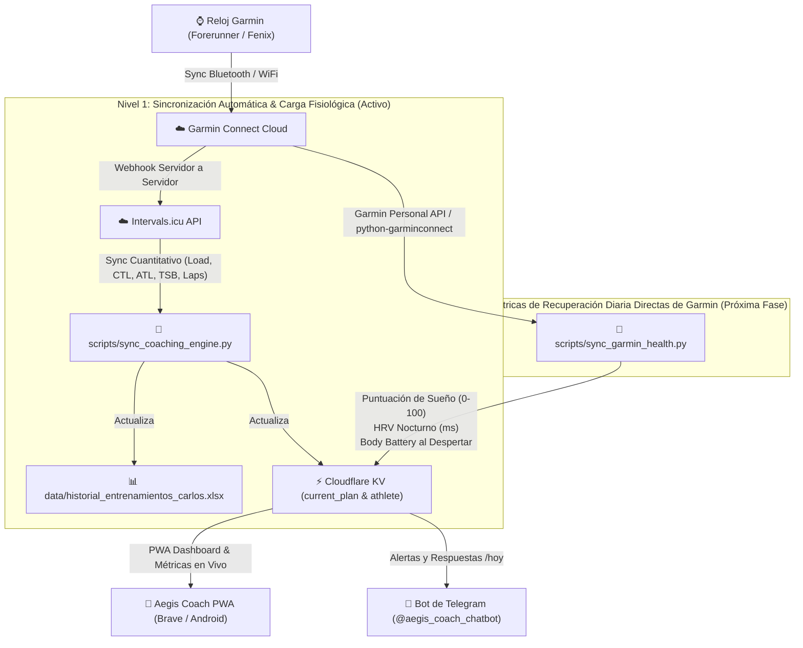

# 🛰️ Guía de Integración Garmin Connect & Intervals.icu — Aegis Coach

Este documento técnico analiza las opciones de conexión con el ecosistema de **Garmin**, evaluando la nueva **API Personal oficial de Garmin**, la librería open-source comunitaria **`python-garminconnect`**, y el puente actual con **Intervals.icu**, definiendo la arquitectura óptima para Aegis Coach.

---

## 1. Comparativa de las 3 Vías de Conexión

| Criterio | Opción 1: Garmin Personal API (Oficial) | Opción 2: `python-garminconnect` (Comunitaria) | Opción 3: Intervals.icu API (Activa en Aegis) |
| :--- | :--- | :--- | :--- |
| **Naturaleza** | API REST Oficial de Garmin para particulares | Librería Python que interactúa con Garmin Connect Web | API REST pública documentada del servicio Intervals.icu |
| **Coste** | Gratuita (Tier Personal) | Gratuita (Open Source) | Gratuita (Key de usuario) |
| **Aprobación Requerida** | Inmediata / Autoservicio en Garmin Connect Web | Ninguna (usa credenciales Garmin) | Ninguna (API Key en cuenta de usuario) |
| **Tipo de Acceso** | **Solo lectura (Pull-only)** | **Lectura y Escritura (Pull & Push)** | **Lectura y Escritura (Pull & Push)** |
| **Datos de Actividad** | Metadatos JSON y descarga de archivos `.FIT` brutos | Métricas, streams por segundo y descarga `.FIT` | Métricas procesadas, laps, zonas y streams |
| **Datos de Salud y Recuperación** | Sueño, HRV nocturno, Body Battery, Estrés, FCR | Sueño, HRV, Body Battery, Estrés, Training Readiness | FCR, Peso, CTL/ATL/TSB (calculados) |
| **Subida de Entrenamientos** | ❌ No soportada en tier personal | ✅ Sí (permite inyectar workouts estructurados al reloj) | ✅ Sí (soporta planificar workouts que se sincronizan al reloj) |
| **Cálculo de Carga Fisiológica** | ❌ Ninguno (entrega datos brutos del reloj) | ❌ Ninguno (entrega datos brutos del reloj) | ✅ **Excelente** (CTL, ATL, TSB, TRIMP, Form, desgloses de intervalos automáticos) |
| **Estabilidad** | Alta (servidor oficial Garmin) | Media-Alta (susceptible a cambios en el SSO de Garmin) | Muy Alta (API REST estable y ligera) |

---

## 2. Opción 1: La Nueva API Personal Oficial de Garmin (2025–2026)

Garmin ha abierto un nivel de autoservicio para usuarios individuales (**Garmin Connect Personal API**), eliminando las barreras del antiguo programa empresarial (Garmin Health Enterprise):

### A. Características Principales
- **Base URL:** `https://personal.connectapi.garmin.com/`
- **Ámbito:** Unipersonal. Diseñada exclusivamente para que cada atleta acceda a sus propios datos biométricos y actividades.
- **Formato:** Respuestas REST JSON y descarga directa de binarios `.FIT` (`/download-service/files/activity/{activityId}`).
- **Restricción:** Es estrictamente de **solo lectura**. No permite enviar entrenamientos al reloj Garmin.

### B. Procedimiento de Activación para Carlos
1. Entrar en **[Garmin Connect Web](https://connect.garmin.com)** desde el navegador en el ordenador.
2. Ir a **Configuración de la Cuenta** &rarr; **Personal API Key** (o acceso directo en portal de desarrolladores).
3. Pulsar en **"Create Key"**, aceptar las condiciones y seleccionar el período de expiración (30 días hasta 1 año).
4. **Copiar y guardar la API Key inmediatamente** (Garmin solo la muestra una vez por motivos de seguridad criptográfica).

### C. Flujo de Autenticación y Endpoints Clave
1. **Intercambio de Token:**
   ```bash
   curl -X POST 'https://personal.connectapi.garmin.com/personalapitoken-service/personal-api/personal-api-key/token' \
     -H 'Authorization: ApiKey TU_PERSONAL_API_KEY'
   ```
   Retorna un Bearer Token temporal para las peticiones subsiguientes.

2. **Endpoints de Actividades:**
   - `GET /activitylist-service/activities/search` &rarr; Listado de actividades con ID, tipo, distancia y duración.
   - `GET /download-service/files/activity/{activityId}` &rarr; Descarga el archivo `.FIT` original comprimido con todos los datos segundo a segundo (GPS, FC, cadencia, oscilación vertical, potencia).

3. **Endpoints de Salud y Recuperación Diaria:**
   - `GET /wellness-service/wellness/dailySleepData` &rarr; Puntuación de sueño (0-100), fases (profundo, ligero, REM) y tiempo despierto.
   - `GET /wellness-service/wellness/dailyHrvData` &rarr; Estado de HRV nocturno (media semanal, valor de la noche en ms y estado equilibrado/bajo).
   - `GET /wellness-service/wellness/dailyStress` &rarr; Nivel de estrés y picos diarios.
   - `GET /wellness-service/wellness/bodyBattery` &rarr; Niveles de Body Battery (carga al despertar y drenaje diurno).

---

## 3. Opción 2: Librería Python Comunitaria `python-garminconnect`

Repositorio GitHub de referencia: [cyberjunky/python-garminconnect](https://github.com/cyberjunky/python-garminconnect) (más de 1.6k estrellas).

### A. Ventajas
- **No requiere registro en el portal de desarrolladores de Garmin.** Se autentica con el usuario y contraseña de Garmin Connect mediante el flujo SSO y almacena tokens OAuth en disco (`~/.garminconnect`).
- **Permite subir entrenamientos planificados al reloj:** Puede generar y enviar sesiones de series estructuradas (ej: $3 \times 500\text{m}$ con 2'30" de pausa) directamente al calendario del Garmin Forerunner de Carlos.
- **Acceso a métricas propietarias:** Sleep Score, Body Battery, Training Readiness, VO2max estimado por Garmin y estado de entrenamiento.

### B. Ejemplo de Código en Python:
```python
from garminconnect import Garmin
import datetime

# Autenticación con sesión persistente
client = Garmin("carlosjimand03@gmail.com", "TU_PASSWORD")
client.login()

# Obtener datos de salud de hoy
today = datetime.date.today().isoformat()
sleep_data = client.get_sleep_data(today)
hrv_data = client.get_hrv_data(today)
body_battery = client.get_body_battery(today)
stats = client.get_user_summary(today)

print(f"Puntuación de Sueño: {sleep_data.get('dailySleepDTO', {}).get('sleepScores', {}).get('overall', {}).get('value')}")
print(f"HRV Nocturno: {hrv_data.get('hrvSummary', {}).get('lastNightAvg')} ms")
print(f"Body Battery al Despertar: {body_battery[-1].get('charged')}")
```

---

## 4. Opción 3: Puente Intervals.icu (La Arquitectura Actual de Aegis Coach)

### Por qué Intervals.icu es una pieza clave:
1. **Sincronización Automática Transparente con Garmin:**
   - Carlos finaliza su sesión en el reloj Garmin &rarr; Garmin Connect la recibe &rarr; En menos de 20 segundos, Garmin la envía a Intervals.icu por webhook oficial de servidor a servidor.
   - Carlos no tiene que hacer nada manual; no requiere scripts corriendo en su ordenador.
2. **Cálculos Fisiológicos Avanzados Incluidos:**
   - Garmin entrega métricas brutas. Intervals.icu calcula matemáticamente:
     - **Fitness (CTL):** Carga crónica a 42 días.
     - **Fatiga (ATL):** Carga aguda a 7 días.
     - **Forma (TSB):** $TSB = CTL - ATL$ (clave para afinar el pico pre-cross).
     - **TRIMP y Carga de Entrenamiento (Load):** Calculada según zonas fisiológicas individualizadas.
     - **Detección Automática de Intervalos y Laps:** Desglosa cada serie de pista o cross con ritmo medio, FC media, cadencia y desnivel.
3. **API Ultraligera y Gratuita:**
   - La API de Intervals.icu se consulta con un único header (`Authorization: Basic ...`) sin expiración diaria de tokens ni flujos complejos de OAuth.

---

## 5. Arquitectura Híbrida Recomendada para Aegis Coach

Para alcanzar la máxima potencia sin añadir fragilidad al sistema, la arquitectura ganadora es **híbrida de 2 niveles**:



### Plan de Acción Inmediato:
1. **Mantener Intervals.icu como motor central de carrera:** Garantiza que los ritmos, tiempos de paso y cálculo de TSB/CTL funcionen sin interrupción.
2. **Añadir Módulo Opcional de Salud Garmin (`scripts/sync_garmin_health.py`):**
   - Cuando Carlos active su Personal API Key en Garmin Connect o introduzca credenciales, este script leerá el sueño, HRV nocturno y Body Battery de la noche previa.
   - Esos 3 indicadores se inyectarán en la tarjeta del Dashboard de la PWA bajo la categoría *"Estado de Recuperación Matutina"*, permitiendo que el Agente Fisiólogo ajuste los ritmos de las series si Carlos amanece con un HRV deprimido o un sueño inferior a 60/100.
